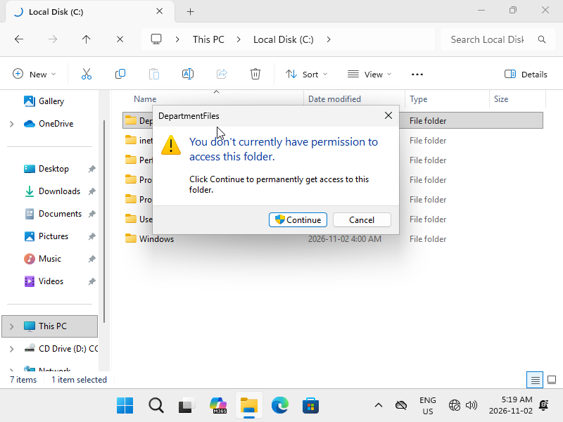
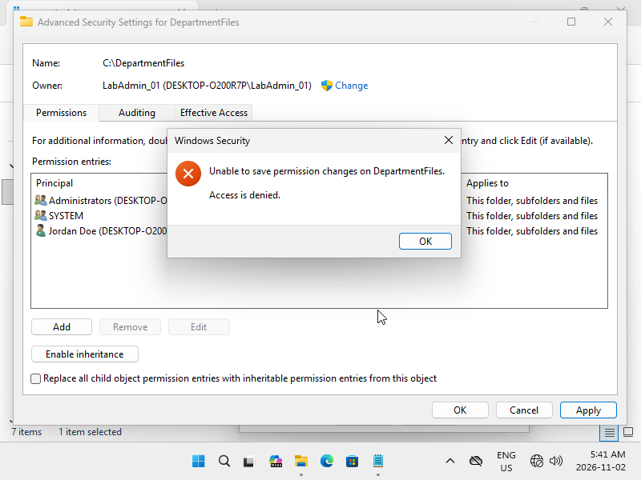
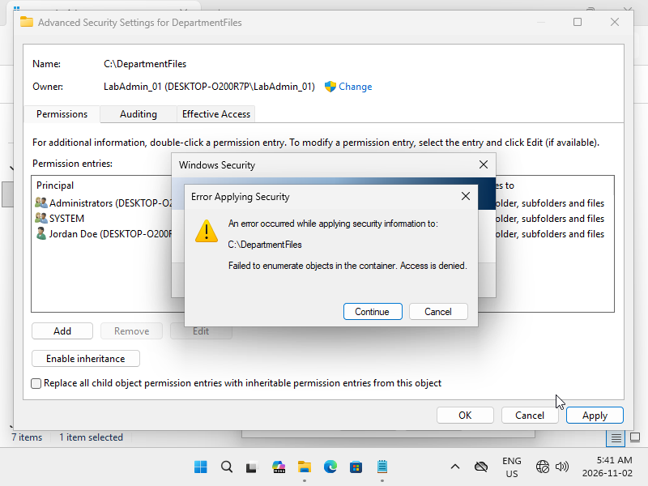
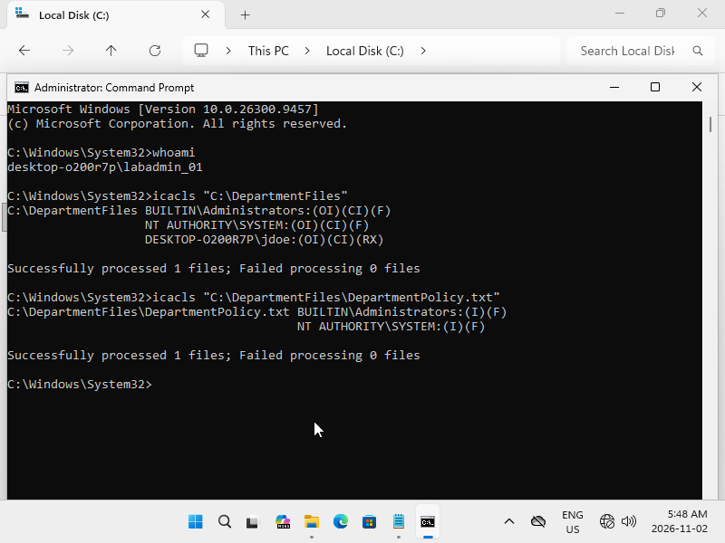
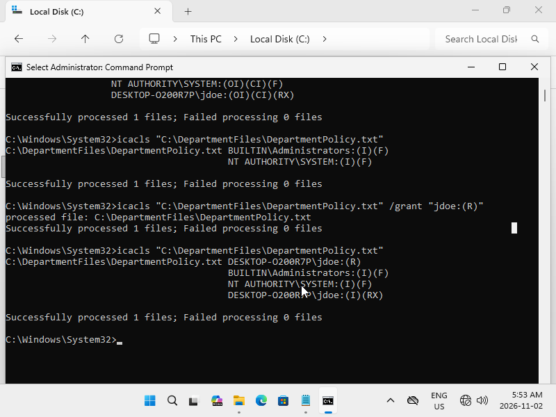
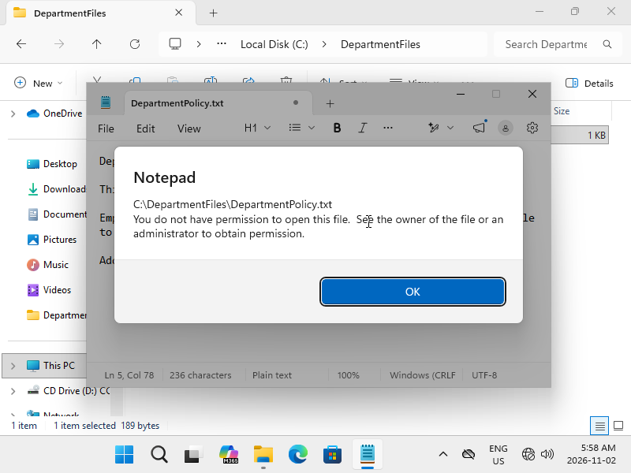

# Lab 03 — Windows File Permissions and Access Control

**Incident:** INC-003 — Department Folder Access Denied  
**Status:** Resolved  
**Category:** Access Management / NTFS Permissions  
**Environment:** Windows 11 Pro

## 1. Objective

Simulate and resolve an employee file access issue by investigating NTFS permissions, configuring read-only access, and applying the principle of least privilege.

## 2. Incident Scenario

Employee Jordan Doe (`jdoe`) was unable to access the departmental folder located at `C:\DepartmentFiles`.

The Service Desk was tasked with restoring access while ensuring the employee could read documents without modifying them.

## 3. Investigation

Initial inspection revealed inherited NTFS permissions from `C:\`, including Modify access for Authenticated Users.

To reproduce the incident, inheritance was disabled and standard-user access was removed from the test folder.

Windows subsequently displayed an **Access Denied** error when `jdoe` attempted to open the folder.

During remediation, the graphical permissions editor also produced an access-denied error. Further investigation using `icacls` revealed different permissions on the folder and its contained file.

### Commands Used

```cmd
whoami
icacls "C:\DepartmentFiles"
icacls "C:\DepartmentFiles\DepartmentPolicy.txt"
```

## 4. Resolution

Configured `jdoe` with Read & execute permissions on the department folder and granted Read permission on the policy document.

```cmd
icacls "C:\DepartmentFiles\DepartmentPolicy.txt" /grant "jdoe:(R)"
```

Full Control permissions for Administrators and SYSTEM were preserved.

## 5. Verification Results

| Test | Result |
|---|---|
| Reproduce Access Denied | Passed |
| Open department folder | Passed |
| Read department policy | Passed |
| Save unauthorized changes | Denied as expected |
| Preserve administrator access | Passed |

**Outcome:** Restored read-only access without granting unnecessary modification privileges.

## 6. Supporting Evidence

### Initial Permissions and Incident





### Troubleshooting and Resolution









## 7. Skills Demonstrated

- NTFS permissions and inheritance
- Access control lists (ACLs)
- Windows user access management
- Command-line troubleshooting with `icacls`
- Principle of least privilege
- Incident investigation and resolution

## 8. Conclusion

Successfully reproduced and resolved an NTFS access issue by investigating folder and file permissions, correcting access control entries, and verifying read-only access.

**Incident INC-003: Resolved.**