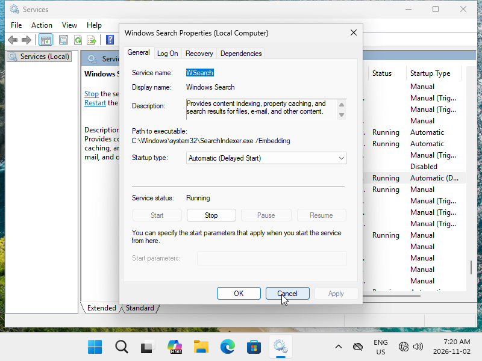
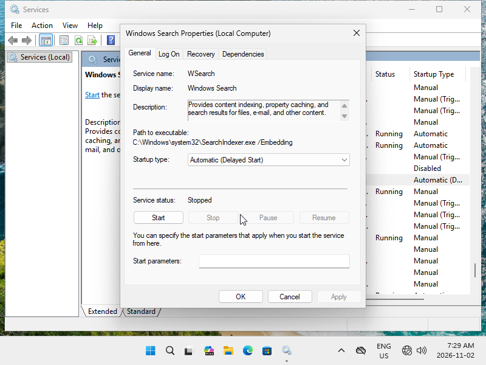
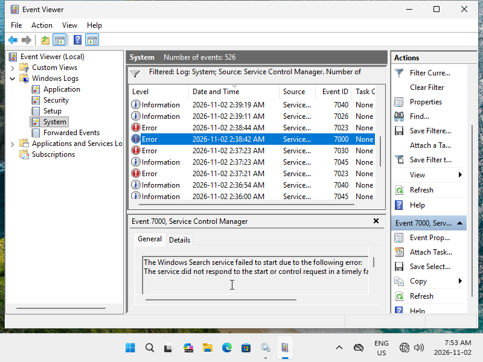
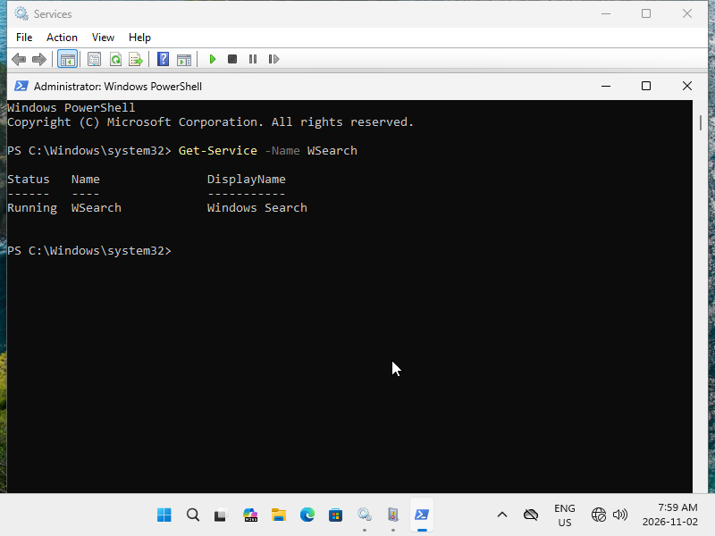

# Lab 04 — Windows Services and Event Viewer Troubleshooting

**Incident:** INC-004 — Windows Service Interruption  
**Status:** Resolved  
**Category:** Windows Services / Incident Management  
**Environment:** Windows 11 Pro

## 1. Objective

Investigate a Windows service interruption using Services, Event Viewer, and PowerShell, then restore and verify normal operation.

## 2. Incident Scenario

Simulated an interruption of the Windows Search (`WSearch`) service to practice service troubleshooting and recovery.

## 3. Investigation

- Confirmed Windows Search was initially running with an Automatic (Delayed Start) startup configuration.
- Intentionally stopped the service to simulate an interruption.
- Examined Windows System logs using Event Viewer.
- Identified an earlier Service Control Manager Event ID **7000**, indicating a Windows Search startup timeout.
- The underlying cause of the earlier startup error was not determined.

## 4. Resolution

Restarted Windows Search through the Services management console.

Verified the service state using PowerShell:

```powershell
Get-Service -Name WSearch
```

**Result:** `Running`

## 5. Verification

| Test | Result |
|---|---|
| Initial service inspection | Passed |
| Service interruption simulation | Passed |
| Event Viewer investigation | Passed |
| Service restart | Passed |
| PowerShell status verification | Passed |

## 6. Supporting Evidence

### Initial Service Configuration



### Service Interruption



### Event Viewer Investigation



### Service Recovery



## 7. Skills Demonstrated

- Windows service administration
- Service Control Manager event analysis
- Windows Event Viewer troubleshooting
- PowerShell service verification
- Incident documentation and recovery

## 8. Conclusion

Successfully simulated a Windows service interruption, investigated relevant system events, and restored Windows Search to its running state.

**INC-004: Resolved.**